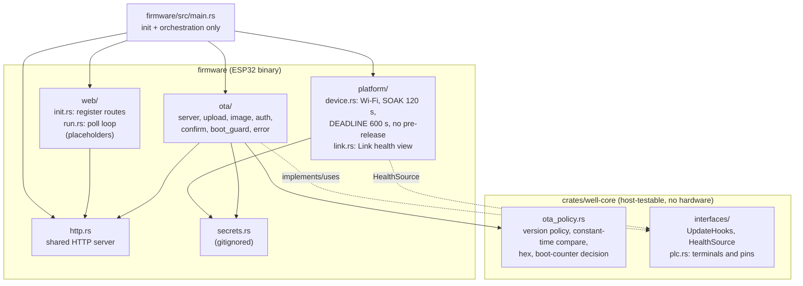
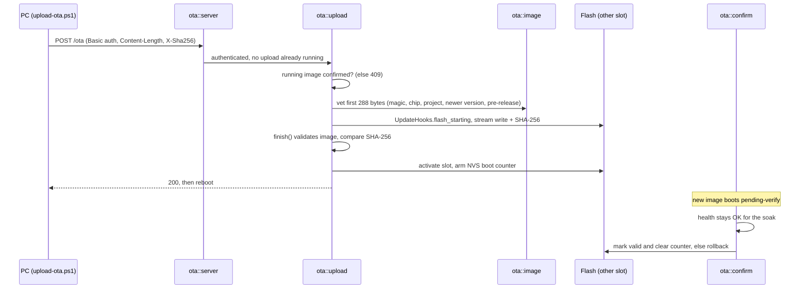

# buzsak-well-pump

Rust firmware for an Industrial Shields ESP32 PLC 14 IO (`14iosplc_v`, 16 MB flash) that controls a well pump and a tank pump. It is the Rust port of an Arduino/C++ firmware; see [backlog.md](backlog.md) for the plan and what is done.

Current state: a safe LAN OTA update path (rollback on an unhealthy image), tested in a simulator. The pump control logic, I/O and the web page are not ported yet; `firmware/src/web/` only holds placeholders.

## Layout

| Path | Purpose |
|---|---|
| `firmware/src/main.rs` | Initialisation and orchestration |
| `firmware/src/platform/` | Device vs simulator network and timing; the only place that differs between the two builds (`qemu` cargo feature) |
| `firmware/src/http.rs` | The shared HTTP server |
| `firmware/src/web/` | Placeholders for the web page: `init` (route registration) and `run` (loop work) |
| `firmware/src/ota.rs`, `firmware/src/ota/` | OTA routes, upload, image vetting, auth, confirm/rollback, boot counter |
| `firmware/src/secrets.rs` | Credentials (gitignored, see below) |
| `firmware/partitions.csv`, `firmware/sdkconfig.defaults` | Flash layout and ESP-IDF config (rollback enabled) |
| `crates/well-core` | Hardware-free parts, tested on the host with `cargo test`: OTA policy and `interfaces` (PLC terminals and pins in `plc.rs`, plus the `UpdateHooks` and `HealthSource` traits) |
| `sim/` | QEMU simulator harness (`Sim.psm1`, `sdkconfig.qemu`) and `tests/Run-OtaTests.ps1` |
| `scripts/make-ota-image.ps1` | Builds the release firmware and the OTA `.bin` with its SHA-256 |
| `scripts/upload-ota.ps1` | Uploads an image to a device and waits for it to confirm (only run by hand) |

## Architecture

Startup order in `main()`:

1. Logger, then NVS.
2. `BootGuard::check_boot()`. It runs first, so an image that keeps failing is rolled back before it does anything else.
3. `platform::at_boot()`, then `start_network()` (Wi-Fi started, no wait for a connection).
4. One HTTP server; `web::register` and `ota::register` attach their routes.
5. `ota::confirm_when_healthy(health, boot_guard)` starts the soak watcher thread.
6. `network.keep_connected()` blocks forever and retries the link.

OTA update flow:

Rollback has two layers: the bootloader (the slot stays pending-verify until the soak passes) and the NVS boot counter (after 3 unconfirmed boots the previous slot is restored, for a bootloader that cannot roll back).

Design rules:

- `main.rs` contains no logic; each module owns one concern.
- `platform/` is the only place where the device and simulator builds differ (`qemu` feature); the OTA code has no feature checks.
- Decisions live in `well-core` (versions, credentials, rollback counter) as pure functions tested on the host; the firmware only does I/O around them.
- `UpdateHooks` and `HealthSource` are the seams to the future I/O layer; the OTA path never knows about pumps.
- The network never gates control logic: a down link is only retried.

Known gaps:

- `LogHooks` in `main.rs` is a stand-in that drives no outputs, so "outputs off before flashing" is not real until the I/O layer exists.
- Health is only "link is up"; real checks (I2C expander, ADC plausibility, scan loop alive) come with the I/O layer.
- `web::poll` is never called and `web::register` registers no routes yet; `interfaces/plc.rs` is not used by the firmware yet.
- Auth is Basic over plain HTTP: acceptable on a LAN, but the credentials are visible to anyone on it.
- The main thread is dedicated to `keep_connected()`; a future scan loop needs its own thread or task.

## Setup

1. Install the ESP Rust toolchain (`espup`), `ldproxy` and `espflash`.
2. Copy `firmware/src/secrets.rs.example` to `firmware/src/secrets.rs` and fill it in.
3. Host tests (repo root): `cargo test`
4. Firmware build (PowerShell): `cd firmware; . $env:USERPROFILE\export-esp.ps1; cargo build`

Notes:
- `firmware/.cargo/config.toml` sets `target-dir = "C:/bw"` because esp-idf-sys rejects long output paths on Windows; adjust it for your machine.
- There is deliberately no cargo `runner`, so `cargo run` never flashes a device.
- ESP-IDF v5.5.3 is installed globally by the build.

## OTA image

`scripts/make-ota-image.ps1` writes `C:\bw\ota\buzsak_well.bin` and `.sha256`. An upload is `POST /ota` with Basic auth, `Content-Length` and an `X-Sha256` header; `GET /ota/status` reports the running slot and its state. A new image is only confirmed after a healthy soak, otherwise the bootloader rolls back; a boot counter in NVS restores the previous image if the bootloader cannot. Production images refuse pre-release versions (`1.2.3-suffix`); the simulator accepts them so tests can stamp versions.

## Simulator and tests

The OTA path is tested against the real firmware in QEMU (ESP32, emulated Ethernet); no device is involved. Requires PowerShell 7, the Espressif QEMU build and Git's `mingw64\bin` (for `libiconv-2.dll`).

`pwsh -File sim\tests\Run-OtaTests.ps1 -Build` builds the simulator firmware into `C:\bwq` (several minutes the first time) and runs seven cases: boot, authentication, wrong SHA-256, not newer, not an ESP image, update to the other slot, second update back. There is no fault injection yet. The simulator listens on `127.0.0.1:18080`.

QEMU does not survive the firmware's own software reset (the rebooted image panics in early init), so after an accepted update the harness power-cycles QEMU on the same flash image. The bootloader, slot selection and rollback bookkeeping still run for real.
